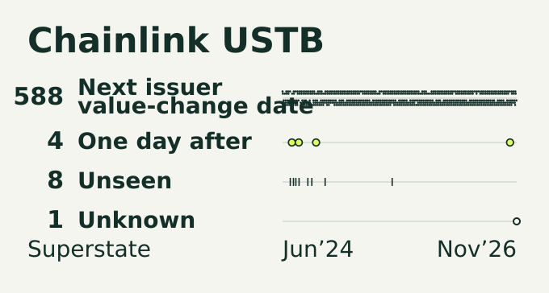

# How quickly do Ethereum feeds post Superstate’s USTB NAV?

Chainlink posted **588 of 601 USTB NAV values on the next date Superstate’s labelled NAV changed**, usually around **9:10 a.m. New York time**. Four appeared a day after that date. Eight were unseen at the study cutoff, including seven from 2024. The last value appeared onchain, but the issuer history ends before its next change. The count covers June 27, 2024 through November 24, 2026 issuer labels.



## Results

**The like-for-like comparison is 2026.** Across the [224 shared labels from January 1 to November 24, 2026](docs/RESULTS.md#chronicle-comparison), Chainlink posted 222 values on the next NAV change date and the Chronicle consumer posted 205. Exact values left unseen: 0 for Chainlink and 11 for Chronicle. Eight of Chronicle’s 11 have no write within 0.1 bp of the NAV, which fits a skipped label day. For the other three, Chronicle wrote a value 0.005 to 0.075 bp from the NAV on the successor date, so exact match counts them as unseen but they look like a precision or revision difference.

The full 340-label window (July 16, 2025 to November 24, 2026) gives 337 and 236 on date, with one and 93 unseen. Read the 93 with care: 82 of them are 2025 labels (July 16 to November 18). Before November 11, 2025 (UTC) the Chronicle consumer wrote 216 values, none equal to any of the 601 USTB labels. They do not track the NAV: they range from $6.16 to $11.73 and 171 have two decimals or fewer. The 2025 labels therefore measure when that consumer began carrying the NAV, not missed deliveries by a NAV feed.

**582 of 593** Chainlink changed answers posted on the literal next NYSE session date. Exactly one session elapsed for 584, including two Saturday posts. Issuer value-change dates approximate the valuation schedule. The issuer’s actual strike and publication times are unknown. Chainlink identifies its source as the Asset Manager API and names Superstate as the auditor in its directory.

[Results and chart](docs/RESULTS.md) · [Method](docs/METHOD.md) · [Sources and digests](docs/SOURCES.md) · [Draft posts](posts/DRAFTS.md)

## How it works

The primary pair is the USTB NAV per Share proxy on Ethereum and Superstate’s USD NAV/share history. The comparison verifies both historical proxy phases and uses the state at block **26,503,879** as its cutoff. The [Chronicle comparison](docs/RESULTS.md#chronicle-comparison) uses the complete pinned consumer history and a common label cohort from July 2025 through November 24, 2026. The original six-product screen also found dated Franklin BENJI/FOBXX filed market-based NAV and USDY LLC accrued note principal per token. OUSG accounting supports a return comparison. BUIDL and USYC lacked a suitable public offchain series in the sources checked.

[NavBridge’s simulated oracle data](docs/SOURCES.md#research-plan-leads) and [Chainlink’s published heartbeat](docs/SOURCES.md#ustb) provide reference points. This audit measures delivery on real data, lists the issuer values skipped through the cutoff and checks delivered values for exact agreement.

## Run it

Requires Python 3.10+ and IANA timezone data. PDF extraction requires Poppler’s `pdftotext`. The method examples use optional `jq`. All fetches are public reads. Run the capture commands through the host workload scheduler where one is required. Data and receipts are written under ignored `data/`.

```sh
python3 -m unittest discover -s tests -v
python3 scripts/issuer_history.py
python3 scripts/feed_history.py capture
python3 scripts/feed_history.py replay > data/ustb/results.json
python3 scripts/render_chart.py data/ustb/results.json docs/ustb-gap.svg --check
python3 scripts/chronicle_check.py capture
python3 scripts/chronicle_check.py replay > data/chronicle/results.json
python3 scripts/issuer_history.py --live > data/issuer-history-live.json
python3 scripts/report_checks.py capture
python3 scripts/report_checks.py replay > data/ousg/results.json
```

The Chainlink replay verifies both chain captures and the normalized pre-cutoff issuer history before it reports round-level joins, daily gaps and month ends. The raw full-response hash can change as the source adds later dates. If an archival endpoint is unavailable, pass a public, archive-capable URL with `--rpc` and rerun the capture at the same blocks. Chronicle uses Blockscout v2 for discovery, MEV Blocker for the full log sweep and batched receipt/header checks, and dRPC for historical state. To change the log transport or range size, use `--log-rpc`, `--log-span` and `--log-batch`. See [input verification and commands](docs/METHOD.md#replay-and-verification) for the USDY reports and EDGAR options.

Live issuer replay skips EDGAR by default. Set `SEC_USER_AGENT` locally to genuine organization identification and an authorized nonpersonal contact to include EDGAR. Add `--verify-indices` to check submission identities and acceptance times. A one-time generic-client test returned HTTP 403 for the September index and XML. The offline command uses the pinned filing excerpts and records both acceptance times from the public filing indices.

## Repository layout

- `scripts/` contains the replay and retrieval commands.
- `tests/` contains the test suite, research observations, and SEC filing excerpts.
- `docs/` contains the findings, methods and provenance.
- `posts/` contains draft summaries with evidence links.

## Documentation

Public repository: [RahilBhavan/rwa-nav-feed-audit](https://github.com/RahilBhavan/rwa-nav-feed-audit).

- [Results](docs/RESULTS.md) records why each product did or did not qualify.
- [Method](docs/METHOD.md) defines the screen, clocks and extraction steps.
- [Sources](docs/SOURCES.md) lists provenance, retrieval routes and capture hashes.
- [Decisions](docs/DECISIONS.md) records the scope decisions.
- [Current quality review](docs/QUALITY.md) records the independent round-four review (8/10 at `4cd7c98`).

## Sources

Superstate, Circle/Hashnote and Ondo publish the series checked in November 2026. The SEC hosts Franklin's September and October 2026 filings. The source register gives the access dates, response hashes and instructions for the May 2025 USDY LLC reports. [Source register](docs/SOURCES.md)

## Scope and limits

The comparison is retrospective. The issuer date supplies no publication clock. The final block bounds onchain follow-up and the captured official NAV date bounds issuer labels. The Chronicle comparison starts after router activation and uses the same issuer and chain cutoffs for both feeds. This independent project has no affiliation with the providers.

## License

Project code is [MIT-licensed](LICENSE). Third-party sources retain their own terms. The repository includes research results, selected factual observations and source receipts. Full downloaded inputs stay local.

Part of [Rahil Bhavan's projects](https://github.com/RahilBhavan).
