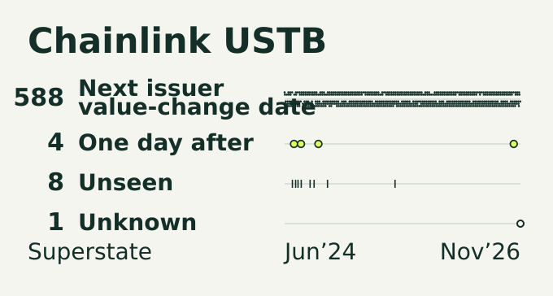

# NAV feed audit results

Across the full USTB Ethereum proxy history through **November 26, 2026**, 584 of 593 changed answers appeared on the next NYSE session date after the matching Superstate label. Every active proxy observation matched a published NAV exactly. Eight issuer values in the overlap never appeared on the active proxy. Chainlink’s directory attributes the feed to the **Asset Manager API** and lists **Superstate** as auditor. Exact agreement measures delivery of a common source. The issuer’s publication time remains unknown. [Inputs and clocks](METHOD.md#join-clocks-and-denominators) · [Source register](SOURCES.md#ustb)

## Full history and coverage

| Check | Full active history, Jun 27, 2024 to Nov 26, 2026 | Review round window, Sep 27, 2025 to Nov 26, 2026 |
| --- | ---: | ---: |
| Active observations matching any issuer value exactly | 889 / 889 | 430 / 430 |
| Distinct issuer values observed by the pin | 593 / 601 | 289 / 289 |
| Calendar labels in the comparison | 883 | 426 |
| Value changes used for elapsed timing | 593 | 289 |
| Changes observed after one NYSE session | 584 | 284 |
| Changes observed after two NYSE sessions | 8 | 5 |
| Changes observed after zero NYSE sessions | 1 | 0 |

The Superstate response contains 1,059 consecutive in-scope date labels from January 3, 2024 to November 26, 2026. An additional November 27 label was outside the cutoff. The narrower **issuer** cohort beginning September 29, 2025 has **288 distinct values on 424 labels**, all observed. The earlier September 27 start for counting **feed rounds** includes two weekend refreshes, and its 289 distinct issuer values include one September 25 carry. The September 26 value first appeared onchain on September 29. Replay exposes both cohort definitions.

At Ethereum block **26,503,879**, historical lookup yielded 46 phase 1 and 874 phase 2 rounds with complete contiguous IDs. The proxy switch at block 20,464,407 in August 2024 leaves 40 of the first phase’s rounds and 849 of the second visible as active latest observations. All 920 stored answers matched an issuer value, including 31 archived rounds from inactive aggregators. Those 31 are excluded from delivery and staleness. The active stream missed the values first labelled July 26, August 7, August 16, August 28, September 30, October 15 and December 4 in 2024, and August 13 in 2025. [Proxy reconstruction](METHOD.md#study-pair-and-cutoff)

## Update timing and intervals

| Measure | Full history | Review round window |
| --- | ---: | ---: |
| Median hours since 00:00 UTC of the matched label, changed rounds | 37.33 h | 37.81 h |
| 90th percentile, changed rounds | 85.26 h | 85.70 h |
| Maximum, changed rounds | 110.18 h | 110.18 h |
| Median New York local time, changed rounds | 09:09:47 ET | 09:10:47 ET |
| Same-phase intervals with both endpoints inside the window | 887 | 429 |
| Median interval | 86,412 s | 86,412 s |
| Intervals over the published 95,400 s heartbeat | 283 | 132 |
| Longest observed interval | 95,484 s | 95,484 s |
| Median / 90th percentile absolute gap to previous UTC label at a round | 0 / 1.19 bp | 0 / 1.01 bp |

The longest date-to-chain case was the Friday, February 13, 2026 label, first posted Tuesday, February 17 at 14:10:47 UTC after the Monday NYSE holiday. In the review round window, 51 of the 58 Friday-labelled changes appeared Monday. All 122 weekend rounds repeated the previous answer, with intervals ending on those rounds ranging from 95,400 to 95,472 seconds. Across the earlier history, two active weekend rounds changed value. The heartbeat is a directory setting observed at capture, and the extra 84 seconds on the longest interval does not identify its trigger or establish a missed service commitment. In the review window that gap ran from October 12, 2025 18:10:59 UTC to October 13 at 20:42:23 UTC. [Timing definitions](METHOD.md#join-clocks-and-denominators)

## Daily gaps

The chart uses nominal USD/share values. Each point is the latest active answer at **23:59:59 UTC**, compared with the same-date issuer label. A gap of −1 bp means the feed is 0.01% below that label. The label may have been published after the comparison instant.

| Case | USD/share onchain | USD/share issuer label | Signed gap |
| --- | ---: | ---: | ---: |
| Jul 29, 2024, largest full-history UTC-close gap | 10.290755 | 10.296792 | −5.8630 bp |
| Aug 31–Sep 2, 2024, Labor Day weekend and holiday | 10.343571 | 10.349578 | −5.8041 bp |
| Oct 14, 2025, largest UTC-close gap in the review window | 10.852878 | 10.857540 | −4.2938 bp |
| Nov 11, 2025, Veterans Day | 10.884770 | 10.888154 | −3.1080 bp |
| Oct 3–4, 2026, weekend example | 11.231053 | 11.232233 | −1.0505 bp |

For each row, compute `10,000 × (onchain − issuer) / issuer` from the unrounded USD/share inputs above. Labor Day was the largest UTC-close holiday gap in the full study under either the federal holiday or NYSE closure calendar. In the later window, **Veterans Day was the maximum gap to the previous UTC date label measured at a round**. Its November 11 update at 16:40:47 UTC retained the November 7 NAV. The issuer carries the November 10 value on November 11. That value appeared onchain on November 12 at 14:10:35 UTC. Veterans Day is a federal holiday and an NYSE session. [Method and calendar definitions](METHOD.md#join-clocks-and-denominators)

For October 3–4, 2026 the feed held the Thursday-labelled value even as the API retained Friday’s higher value across the weekend. The Friday value appeared Monday, October 5 at 13:15:35 UTC (09:15:35 EDT). Within the review round window, the largest weekend UTC-close gap was **−1.9839 bp**, first observed November 29, 2025. [Weekend and holiday inputs](SOURCES.md#ustb)

## Month-end

Across 29 completed NYSE month-ends in scope, 28 month-end label values were observed and 27 appeared one session later. The September 30, 2024 value never appeared. October 30, 2026 took two sessions, posting November 3 at 12:10:23 UTC. In the late-window example, **September 30, 2026’s $11.229908 NAV posted October 1 at 13:17:35 UTC** (09:17:35 EDT). That is 37.29 hours from 00:00 UTC of the label. Replay emits every month-end label and corresponding first observation. [Month-end method](METHOD.md#join-clocks-and-denominators)

## Other products

| Product | Comparable evidence and limit |
| --- | --- |
| BUIDL | BNY documents class-specific NAV onchain, and launch materials state a $1 target. The reviewed offchain materials did not contain dated valuations for a matching share class. [Sources](SOURCES.md#buidl) |
| USTB | Public dated NAV/share and a matched Ethereum primary feed. The Aave wrapper, Chronicle, RedStone and other chains are outside this comparison. [Full history](#full-history-and-coverage) |
| USYC | The API indexes its own onchain price reports. A comparison against its parent feed would reuse the same reports. [Sources](SOURCES.md#usyc) |
| OUSG | Administrator statements support a return check. The checked fund-wide accounts do not expose a corresponding per-token denominator. [Return cross-check](#ousg-return-cross-check) |
| USDY | Ondo USDY LLC reports publish accrued USD/token note principal. The old USDY oracle can be evaluated retrospectively at matched timestamps, subject to the range and clock limits below. [Note principal](#usdy-note-principal) |
| BENJI | Franklin files daily FOBXX market-based NAV per share. No matched BENJI Ethereum Chainlink feed was identified in the checked directory. [Filing availability](#benji-filing-availability) |

The initial dated issuer fund NAV screen admitted USTB and BENJI, **2 of 6**. Including USDY LLC’s distinct accrued principal benchmark gives **3 of 6** dated per-unit references. Offline issuer replay derives these selections from the evidence properties. Live mode reports complete fetched row counts and their date bounds. [Source eligibility](METHOD.md#other-product-references)

### BENJI filing availability

Franklin’s September and October 2026 Form N-MFP3 Item B.6 includes 21 and 22 daily close observations, respectively, all at **$1.0000** per share at reporting precision. The September filing was accepted October 6 at **15:46:56 EDT** and the October filing November 6 at **11:20:09 EST**. Both were accepted six calendar dates after report month-end. October’s acceptance was seven calendar dates after the last valuation label, October 30. These are SEC acceptance offsets, so an earlier public availability time for the valuations remains unknown. A generic-client probe of the September index and XML returned HTTP 403. The acceptance times were separately checked on the publicly rendered index pages. [Filing indices and XML](SOURCES.md#benji)

### OUSG return cross-check

The November document table yielded 14 one-day Ondo I LP account statements through November 25, with dates from November 6 to 25. No earlier November statement appeared in the table snapshot. The minimum, median and maximum absolute residual between derived accounting and chart returns were **0.00000720**, **0.00002232** and **0.01428620 bp**. Thirteen of 14 were within **0.000071 bp**. On November 24, the accounting return was 0.86268802 bp and the chart return 0.84840182 bp. That deviation and the absence of unit-level administrator values leave the chart’s exact lineage open.

For example, on November 23 the formula uses `10,000 × 105,379.91 / (342,831,549.04 + 716,651.64 − 999,978.97)`, giving **3.07635256 bp**. The chart’s November 23 and 24 midnight UTC buckets give `10,000 × (117.373629 / 117.337532 − 1)`, or **3.07633878 bp**. The downloadable evidence receipt lists each statement’s public URL, UTC fetch time and SHA-256. The replay computes every residual directly from the PDFs. [Paired return method](METHOD.md#other-product-references) · [Capture receipt](../tests/evidence/ousg-capture.json)

### USDY note principal

The table compares four May 2025 Ondo USDY LLC **Section C Reference Token** principal figures with the legacy Dynamic Rate Oracle’s `getPrice()` at each report date’s last Ethereum block at or before 23:59:59 UTC. The later retrospective `getPriceHistorical()` computation at study block 26,503,879 returns identical integers for all four dates. The oracle matches all four reports at six-decimal precision, with a largest absolute unrounded difference of **0.00340 bp** relative to the note principal. The report’s end-of-day timezone and publication time remain unknown. [Addresses, reports and contract source](SOURCES.md#usdy)

| Report date | Ethereum block | Report USD/token | Legacy oracle USD/token |
| --- | ---: | ---: | ---: |
| May 2, 2025 | 22,399,543 | 1.088693 | 1.08869325 |
| May 5, 2025 | 22,420,967 | 1.089066 | 1.08906575 |
| May 6, 2025 | 22,428,091 | 1.089190 | 1.08918995 |
| May 9, 2025 | 22,449,297 | 1.089563 | 1.08956263 |

The oracle integers use 18 decimals. To recover the signed difference use `10,000 × (oracle − note) / note`, then compare the oracle rounded to six decimals with the report. These are same-issuer pricing checks against accrued note principal.
